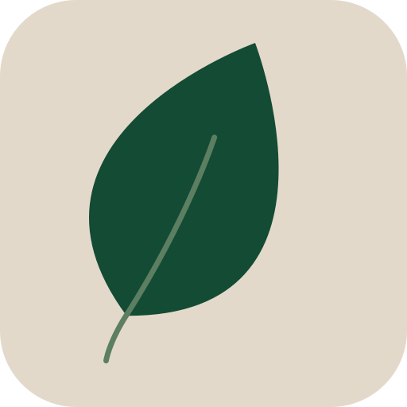

<div align="center">
  
  <h1>Daystash</h1>
  <p><strong>A private journal for the moments worth keeping.</strong></p>
  <p>Capture daily stories with words, photos, and places.</p>
  <p><a href="https://daystash.vercel.app/">Open Daystash</a></p>
</div>

## Highlights

- **Flexible journal entries** — Build each story from reorderable text, list, and image blocks.
- **Photos from any device** — Upload directly or scan a QR code to add photos from your phone.
- **Place-based memories** — Attach locations with Google Places and bias results toward nearby places.
- **A visual archive** — Browse entries by month, jump through the timeline, and choose a cover image for each journal.
- **Fast search** — Find past entries by title or content.
- **Installable experience** — Use Daystash as a responsive PWA with light and dark themes.

## Built with

Next.js 16 · React 19 · TypeScript · Tailwind CSS · Supabase · Cloudinary · TanStack Query · Jotai · Vitest · Codex

## Run locally

```bash
npm install
npm run dev
```

Create `.env.local` and provide the services used by the app:

```bash
NEXT_PUBLIC_SITE_URL=
NEXT_PUBLIC_SUPABASE_URL=
NEXT_PUBLIC_SUPABASE_ANON_KEY=
SUPABASE_SERVICE_ROLE_KEY=
NEXT_PUBLIC_CLOUDINARY_CLOUD_NAME=
NEXT_PUBLIC_CLOUDINARY_UPLOAD_PRESET=
GOOGLE_MAPS_API_KEY=
```

Then open [http://localhost:3000](http://localhost:3000).

## Quality checks

```bash
npm run lint
npm run test:run
npm run build
```
